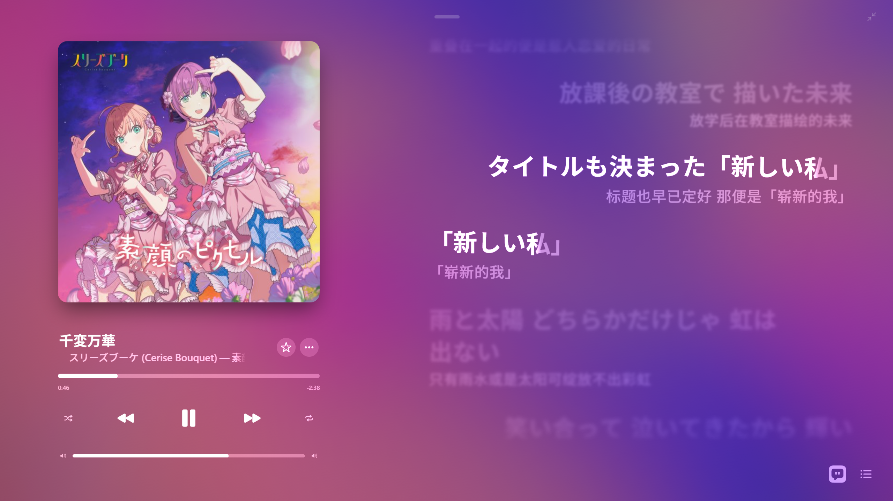
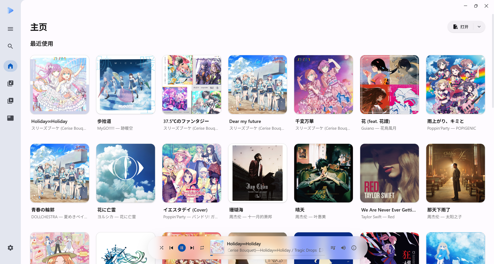
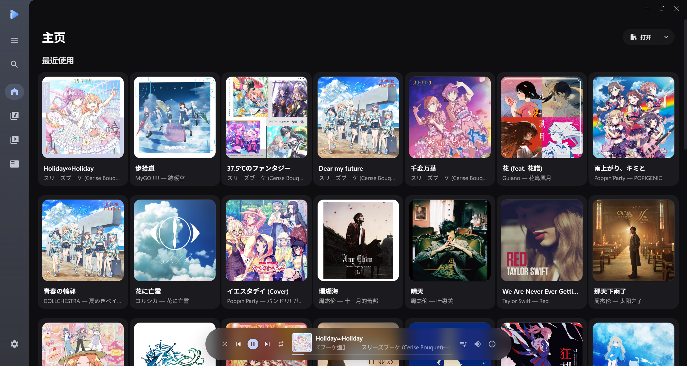
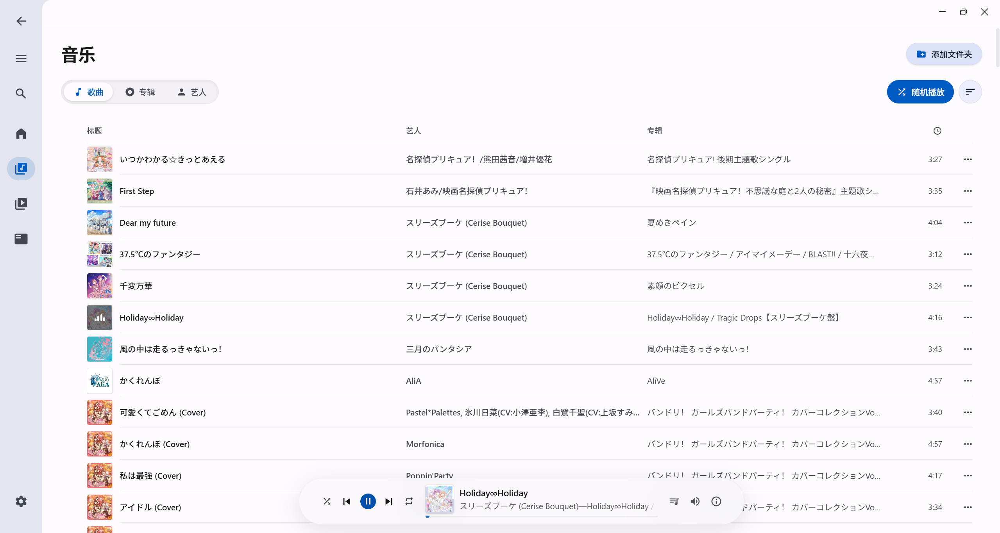
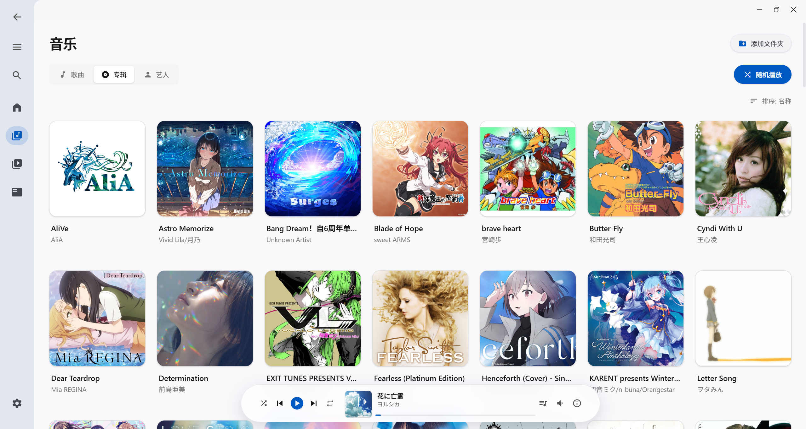
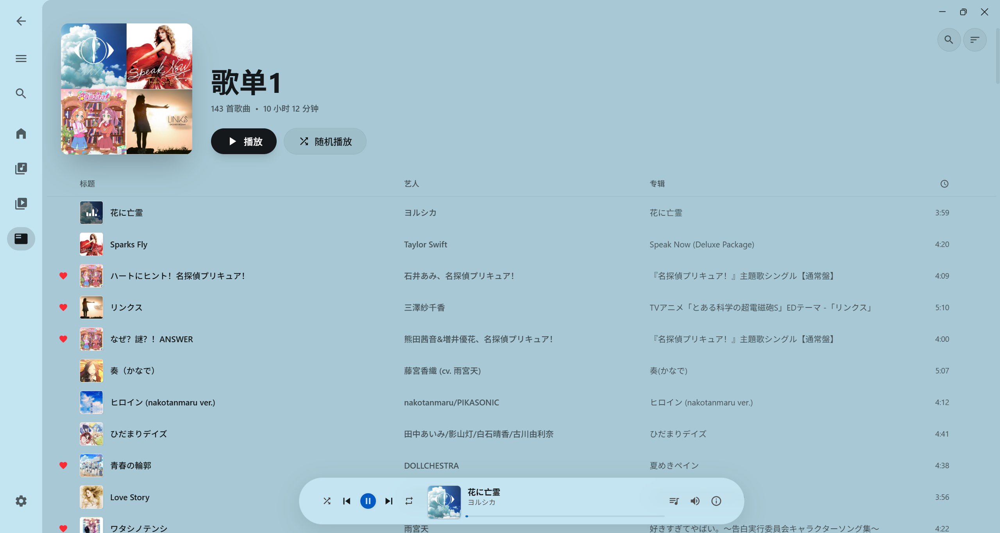
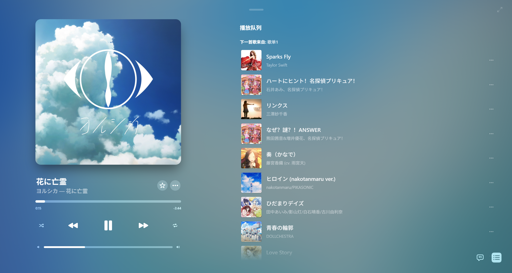

<div align="center">
  
  <h1>Simple Player</h1>
  <p>轻量级的本地音乐与视频播放器</p>
  <p>
    
    <a href="LICENSE"></a>
    
  </p>
  <p>
    <a href="https://github.com/Jimie165/simple-player/releases">下载</a> ·
    <a href="#界面预览">界面预览</a> ·
    <a href="docs/TROUBLESHOOTING.md">常见问题</a> ·
    <a href="https://github.com/Jimie165/simple-player/issues">问题反馈</a>
  </p>
</div>

Simple Player 是一款本地音乐与视频播放器。添加文件夹后即可浏览和播放电脑里的音乐和视频。音乐可以按歌曲、艺人和专辑分类查看，也可以创建歌单、收藏喜欢的歌曲。播放时还能进入沉浸式界面，一边看动态背景和逐字歌词，一边听歌。

> Windows 版本已正式发布，macOS 版本仍在适配中，目前提供测试构建。

## 界面预览

### 沉浸式播放



### 浅色与深色主题

<table>
  <tr>
    <th width="50%">浅色主页</th>
    <th width="50%">深色主页</th>
  </tr>
  <tr>
    <td></td>
    <td></td>
  </tr>
</table>

### 竖屏布局

<table>
  <tr>
    <th width="50%">主页</th>
    <th width="50%">沉浸式播放</th>
  </tr>
  <tr>
    <td align="center"></td>
    <td align="center"></td>
  </tr>
</table>

<details>
<summary>查看更多：音乐库、歌单、播放队列和视频库</summary>

<table>
  <tr>
    <th width="50%">歌曲列表</th>
    <th width="50%">专辑视图</th>
  </tr>
  <tr>
    <td></td>
    <td></td>
  </tr>
  <tr>
    <th>歌单</th>
    <th>播放队列</th>
  </tr>
  <tr>
    <td></td>
    <td></td>
  </tr>
</table>

<p><strong>视频库</strong></p>


</details>

## 核心特性

- **音乐库**：按歌曲、艺人或专辑浏览本地音乐，支持搜索、收藏、查看最近播放和编辑歌曲信息。
- **沉浸式播放**：支持普通歌词、滚动歌词和逐字歌词，背景会动态变化；把窗口拉窄，播放页会自动切换成竖屏布局。
- **歌单**：把喜欢的歌曲整理成歌单，自定义名称、描述和封面，拖动调整歌曲顺序。
- **播放队列**：查看接下来要播放的歌曲及其来源，随时拖动排序或移除歌曲。临时想听的歌曲可以加入队列，听完后继续原来的列表，也可以单独清空临时加入的歌曲。重新打开应用时会恢复上次的播放队列。
- **视频播放**：添加视频文件夹后即可播放本地视频；遇到不兼容的格式时，应用会自动重封装或转码。
- **外观设置**：主题可以选浅色、深色或跟随系统，也能自定义主题色和变更播放页效果。
- **系统媒体控制**：Windows 使用系统媒体传输控件（SMTC），macOS 使用控制中心的“正在播放”，支持播放、暂停和切歌。
- **音频输出**：在设置中选择音频输出设备，方便在多个设备之间切换。

## 下载与使用

| 平台 | 系统要求 | 下载 |
| --- | --- | --- |
| Windows | Windows 10 / Windows 11，需要 WebView2 运行时 | [Releases](https://github.com/Jimie165/simple-player/releases) 中的 `.exe` 或 `.msi` 安装包 |
| macOS（测试版） | macOS 12+，Intel 或 Apple Silicon；使用系统自带的 WKWebView | [GitHub Actions](https://github.com/Jimie165/simple-player/actions/workflows/macos.yml) 成功完成的手动打包任务中的应用 ZIP 或 DMG |

Windows 安装包下载后直接运行即可。macOS 请按设备架构选择测试包：应用 ZIP 在 Mac 上解压后运行，DMG 打开后将应用拖入“应用程序”。

1. 在音乐库或视频库中点击“添加文件夹”，选择存放媒体的文件夹。
2. 扫描完成后，选择歌曲或视频开始播放。
3. 在设置中调整主题、音频输出设备和其他播放选项。

## 使用说明

应用会扫描以下扩展名的文件：

| 类型 | 扩展名 |
| --- | --- |
| 音频 | `mp3`、`flac`、`wav`、`ogg`、`m4a` |
| 视频 | `mp4`、`mkv`、`avi`、`mov`、`webm`、`flv`、`m4v`、`3gp`、`ts`、`rmvb`、`wmv`、`asf`、`ogv` |

不能直接播放的视频会自动重封装或转码为 MP4，首次播放可能需要等待。缓存位置和容量上限可在设置中调整。

应用默认在启动时检查正式发布版本，也可以在“设置 → 关于”中手动检查或关闭自动检查。有新版本时，可前往发布页面下载安装；macOS 测试构建仍从 GitHub Actions 获取。

媒体库、歌单和播放队列的数据保存在本地，原始音乐和视频文件不会被移动或复制。存储位置见 [Windows 数据与缓存说明](docs/DEVELOPMENT.md#数据与缓存) 和 [macOS 适配与测试](https://github.com/Jimie165/simple-player/blob/macos-support/docs/MACOS.md)，使用问题见 [故障排查](docs/TROUBLESHOOTING.md)。

## 开发与构建

Windows 开发环境和 sidecar 准备方式见 [开发文档](docs/DEVELOPMENT.md)。macOS 开发请使用 [macos-support 分支](https://github.com/Jimie165/simple-player/tree/macos-support)，按 [macOS 构建说明](https://github.com/Jimie165/simple-player/blob/macos-support/docs/MACOS.md) 准备 Xcode Command Line Tools、开发工具链和对应架构的 FFmpeg / FFprobe sidecar。

准备好所用平台的开发环境后运行：

```shell
# 安装依赖
pnpm install

# 启动桌面开发模式
pnpm dev

# 构建当前平台的应用包
pnpm build
```

## 反馈与贡献

欢迎提交 [Issue](https://github.com/Jimie165/simple-player/issues) 或 Pull Request。反馈问题时请附上应用版本、操作系统版本、设备架构、复现步骤和错误信息；播放问题请注明文件格式。参与开发前请阅读对应平台的开发说明。

## 许可证

本项目采用 [GNU General Public License v3.0](LICENSE) 开源。

安装包里附带了 FFmpeg 和 FFprobe。如果你要分发本应用或替换这些文件，请遵守所用 FFmpeg 版本的 LGPL/GPL 许可证。
